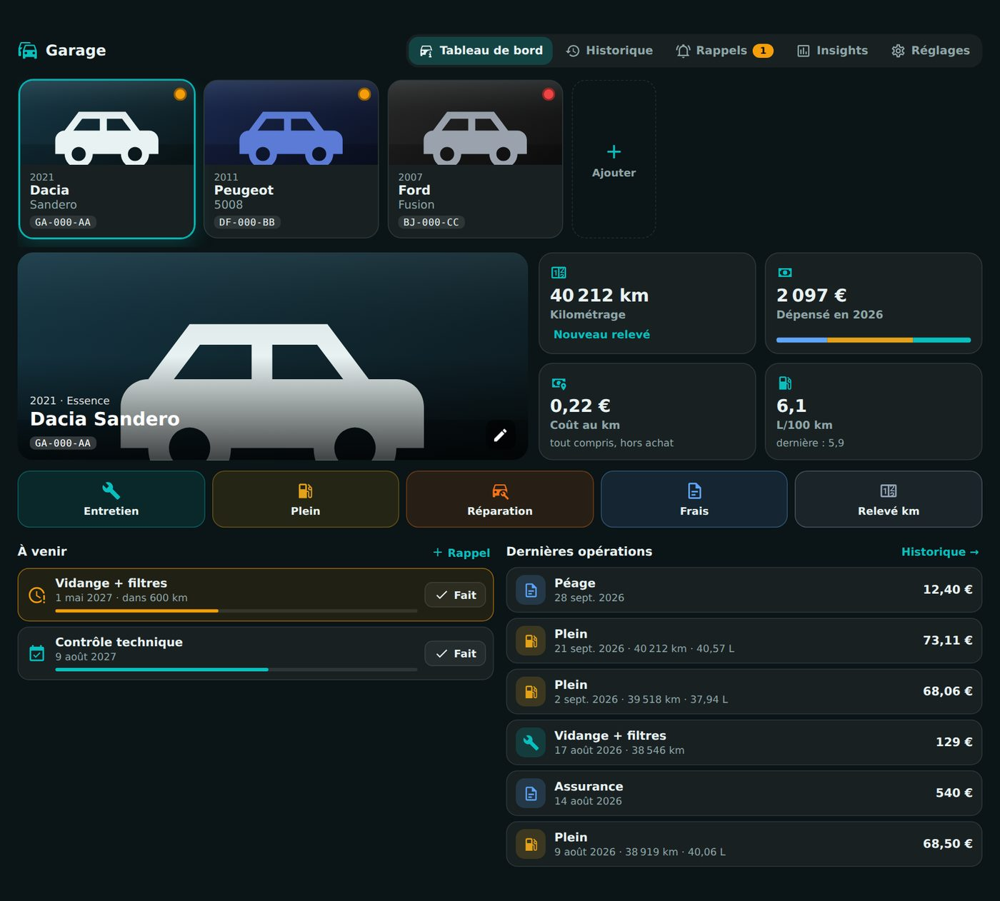
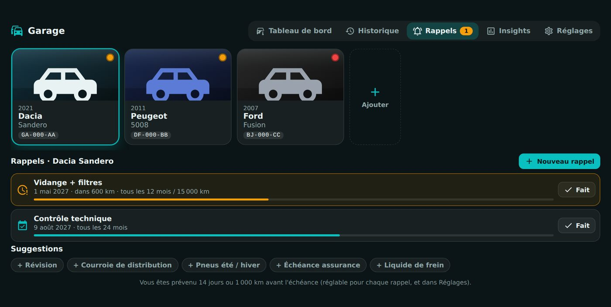
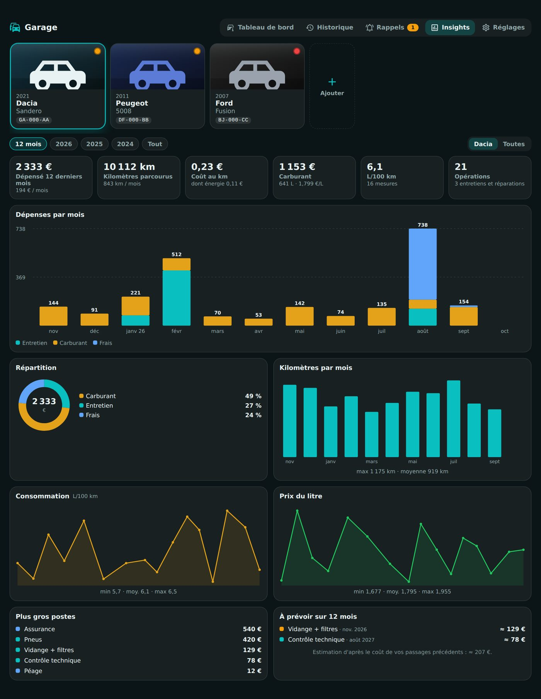
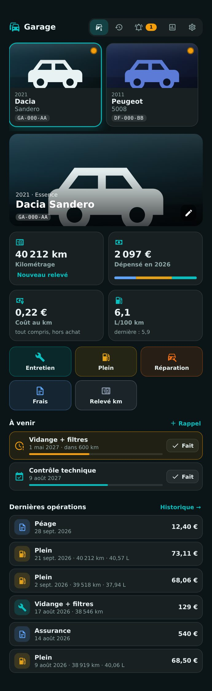

# 🚗 HOLM Cars

[](https://hacs.xyz/)


**L'entretien, les dépenses, les pleins et les recharges de toutes vos voitures, dans Home Assistant.**

HOLM Cars remplace le carnet d'entretien et le tableur : vous notez les entretiens, réparations, pleins et frais, HOLM Cars vous prévient avant le prochain contrôle technique ou la prochaine vidange, et calcule tout ce qu'il y a à savoir : coût au km, consommation, dépenses par mois, kilomètres parcourus… Inspiré de [LubeLogger](https://lubelogger.com), en plus simple et intégré à Home Assistant, avec l'import de vos données LubeLogger.

> ✨ **Zéro YAML, aucun helper.** Une intégration et une carte : tout se fait depuis la carte.



### En bref

- 🚘 **Garage** : tous vos véhicules en vignettes (voiture, moto, scooter, vélo ou trottinette électrique, utilitaire, camping-car…), avec une pastille quand un entretien approche.
- 🧾 **Historique** : entretiens, réparations, équipements, pleins, recharges, frais (assurance, carte grise, péage…) et relevés kilométriques, classés par mois, avec recherche et filtres. Joignez factures et photos.
- 🔔 **Rappels** par date **et/ou** kilométrage, le premier atteint : contrôle technique, vidange, courroie, pneus, assurance… Périodiques : ils se reprogramment quand vous les marquez « Fait ». Notification sur vos téléphones et dans Home Assistant, N jours ou N km avant.
- 📊 **Insights** : dépenses par mois et par poste, coût au km, kilomètres par mois, consommation (L/100 km ou kWh/100 km), prix du litre ou du kWh, plus gros postes, dépenses à prévoir sur 12 mois, comparaison des voitures.
- 🔌 **Voiture connectée** : le kilométrage se met à jour depuis une entité, et chaque fin de recharge crée une recharge (kWh, coût, batterie) à partir des entités de la voiture. Avec un tarif HP/HC ou Tempo, chaque kWh est compté **au prix du moment**.
- 📥 **Import** depuis LubeLogger (API ou CSV), ou depuis **Excel et toute autre application** grâce au **modèle CSV HOLM Cars**. Relancer l'import met à jour sans doublons.
- 📱 Pensé pour le téléphone autant que pour l'ordinateur.

| Rappels | Insights | Sur téléphone |
|---|---|---|
|  |  |  |

---

## Installation

### Avec HACS (recommandé)

1. HACS → menu ⋮ → **Dépôts personnalisés**.
2. Ajoutez `https://github.com/kaaribou/holm-cars`, catégorie **Intégration**.
3. Recherchez **HOLM Cars** → **Télécharger**, puis **redémarrez Home Assistant**.
4. **Paramètres → Appareils et services → Ajouter une intégration → HOLM Cars**.

### Manuellement

Copiez `custom_components/holm_cars` dans `config/custom_components/`, redémarrez, puis ajoutez l'intégration.

La carte est déclarée automatiquement : ajoutez la carte **HOLM Cars** à un tableau de bord.

---

## Utilisation

```yaml
type: custom:holm-cars-card
title: Garage
```

| Option | Description | Par défaut |
|---|---|---|
| `title` | Titre de la carte | `Garage` |
| `view` | `full` (garage, historique, rappels, insights, réglages) ou `vehicle` (carte compacte d'une voiture) | `full` |
| `vehicle` | Voiture affichée en vue `vehicle` (à choisir dans l'éditeur) | — |
| `show_frame` | Afficher le cadre de la carte | `true` |

### Rappels et notifications

Dans **Réglages** : délai d'alerte par défaut (14 jours ou 1 000 km), heure d'envoi, et téléphones à prévenir (services `notify.*`). Chaque rappel peut avoir son propre délai. Une notification est envoyée quand l'échéance approche, puis une autre si elle est dépassée.

Pour vos automatisations, un évènement `holm_cars_reminder` est émis à chaque alerte (`vehicle`, `title`, `state` : `soon` ou `overdue`, `days_left`, `km_left`).

### Voiture connectée

Dans la fiche de la voiture → **Voiture connectée** :

- **Compteur kilométrique** : une entité en km (ou en miles, convertie). Un relevé par jour est enregistré.
- **Recharges automatiques** (électrique ou hybride rechargeable) : l'entité « en charge », l'énergie chargée en kWh (compteur cumulé ou par recharge), le prix du kWh (fixe ou depuis une entité) et, si vous l'avez, le niveau de batterie.

**Coût d'une recharge avec un prix venant d'une entité** (ex. `sensor.tarif_actuel` de [HOLM HP/HC](https://github.com/kaaribou/holm-tarif)) : à chaque hausse du compteur d'énergie pendant la recharge, les kWh ajoutés sont comptés **au prix en vigueur à cet instant**. Une recharge qui commence en heures creuses et finit en heures pleines (ou qui change de couleur Tempo) est donc payée au bon prix. Le coût est la somme des tranches, le prix affiché est le prix moyen, et le détail apparaît dans la recharge (« 18,2 kWh à 0,1296 € · 4,1 kWh à 0,1609 € »). La recharge en cours est conservée si Home Assistant redémarre.

Avec un prix fixe, ou si le compteur n'est connu qu'en fin de recharge, le coût reste kWh × prix.

### Type de véhicule

Dans la fiche du véhicule, choisissez son **type** : voiture, moto, scooter, vélo électrique, trottinette électrique, utilitaire, camping-car ou autre. L'icône s'adapte partout dans la carte ; un vélo ou une trottinette est forcément électrique.

### Import depuis LubeLogger

**Réglages → Importer depuis LubeLogger** :

- **Par l'API** : adresse de LubeLogger vue depuis Home Assistant, et identifiant / mot de passe d'un compte (ou une clé d'API). Choisissez les voitures, l'import récupère tout, photos et factures comprises. Les identifiants ne sont pas enregistrés.
- **Par CSV** : dans LubeLogger, exportez chaque onglet en CSV, puis importez-les un par un dans la voiture voulue. Le type est détecté, les dates françaises et américaines sont reconnues.

### Import depuis Excel ou une autre application (modèle CSV)

**Réglages → Par un fichier CSV → Télécharger le modèle** : ouvrez `modele-holm-cars.csv` dans Excel (ou LibreOffice, Numbers…), remplissez une ligne par opération en recopiant les données de votre ancienne application, enregistrez en CSV, puis importez-le dans le véhicule voulu.

| Colonne | Contenu | Exemple |
|---|---|---|
| `type` | `carburant`, `recharge`, `entretien`, `reparation`, `amelioration`, `frais` ou `km` (des mots proches sont reconnus : plein, vidange, révision, assurance, péage, relevé…) | `entretien` |
| `date` | Date de l'opération (`15/01/2026` ou `2026-01-15`) | `15/01/2026` |
| `km` | Kilométrage au compteur | `45200` |
| `description` | Intitulé | `Vidange` |
| `cout` | Montant (virgule ou point) | `129,90` |
| `quantite` | Litres ou kWh (carburant, recharge) | `38,5` |
| `plein` | Plein / recharge complète : `oui` ou `non` | `oui` |
| `categorie` | Station, garage ou lieu de recharge | `Garage Dupont` |
| `notes` | Remarques | `Huile 5W30` |
| `etiquettes` | Étiquettes séparées par des virgules | `garantie, constructeur` |

- Seule la colonne `date` est obligatoire ; l'ordre des colonnes est libre, les majuscules et les accents sont ignorés (`Coût (€)`, `Kilométrage`, `Quantité` sont reconnus).
- Séparateur `;` ou `,`, encodage UTF-8. Sans colonne `type`, toutes les lignes prennent le type choisi dans la fenêtre d'import.
- Pour un véhicule électrique, les lignes `carburant` deviennent des recharges. Les lignes déjà importées sont ignorées.

## Entités

Pour chaque voiture (un appareil par voiture) :

| Entité | Description |
|---|---|
| `sensor.<voiture>_kilometrage` | Kilométrage actuel |
| `sensor.<voiture>_prochain_entretien` | Jours avant le prochain rappel (titre, date, km restants en attributs) |
| `sensor.<voiture>_depenses_de_l_annee` | Dépenses de l'année en cours |
| `sensor.<voiture>_cout_au_km` | Coût au km (hors achat) |
| `sensor.<voiture>_consommation_moyenne` | L/100 km ou kWh/100 km |
| `binary_sensor.<voiture>_entretien_a_prevoir` | Allumé quand un rappel approche ou est dépassé |

## Vos données

Tout reste chez vous : les données sont dans `config/.storage/holm_cars`, les photos et factures dans `config/holm_cars/`. Les fichiers ne sont accessibles qu'aux utilisateurs connectés de Home Assistant, et sont inclus dans vos sauvegardes.

## FAQ

| Question | Réponse |
|---|---|
| Pas de consommation affichée | Il faut deux pleins (ou recharges) **complets** avec le kilométrage. Cochez « Un plein précédent manque » si vous en avez oublié un. |
| L'import API échoue | L'adresse doit être joignable depuis Home Assistant (pas `localhost`). Essayez une clé d'API, ou l'import CSV. |
| Mon application n'est pas LubeLogger | Exportez vos données en CSV ou Excel, puis recopiez-les dans le **modèle CSV HOLM Cars** (voir plus haut). |
| La carte ne s'affiche pas | Videz le cache du navigateur (Ctrl + F5) après une mise à jour. |

---

## Un petit merci ?

L'intégration vous plaît ? Vous pouvez m'offrir une bière 🍺

[](https://paypal.me/kaaribou)

---

## Licence

Code : licence **MIT** — © kaaribou. Voir le [CHANGELOG](CHANGELOG.md). Import compatible avec [LubeLogger](https://lubelogger.com) (projet indépendant, sans lien avec HOLM).

Fait partie de **HOLM — Home Orchestration & Living Management** : la gestion et l'orchestration intelligente de la maison.

Les autres projets : [Carburant HOLM](https://github.com/kaaribou/carburant-holm) · [HOLM LaMetric](https://github.com/kaaribou/lametric-holm) · [HOLM My Menu](https://github.com/kaaribou/holm-mymenu) · [HOLM Navbar Card](https://github.com/kaaribou/holm-navbar-card) · [HOLM Climate Card](https://github.com/kaaribou/climate-card-holm) · [HOLM Music Card](https://github.com/kaaribou/holm-music-card) · [HOLM Sentinel Card](https://github.com/kaaribou/holm-sentinel-card) · [HOLM Radiator Card](https://github.com/kaaribou/holm-radiator-card) · [HOLM Floor Card](https://github.com/kaaribou/holm-floor-card) · [HOLM Ecojoko Card](https://github.com/kaaribou/holm-ecojoko-card).
